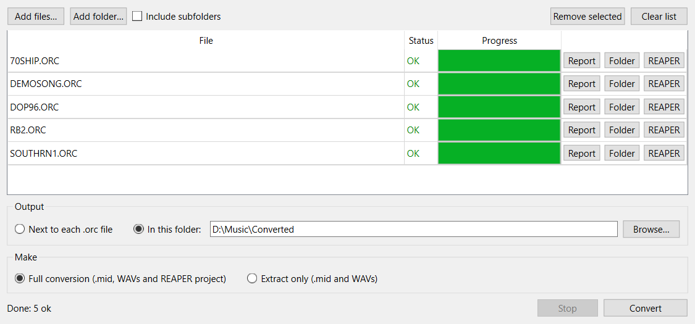

# dop-extract

Converts **Voyetra / Turtle Beach Digital Orchestrator Plus / Pro** project
files (`.orc`) into plain MIDI and WAV files, plus a **REAPER** project that
opens with every track in place.

Digital Orchestrator was a mid-90s Windows MIDI + audio sequencer.  Its
`.orc` files hold the MIDI tracks and every audio recording, but the audio
is stored as one cut-up stream with a private clip list.  No other tool
reads that clip list, so recordings come out scrambled or not at all.
dop-extract decodes it (see [FORMAT.md](FORMAT.md)).



## What you get

For `song.orc`, a folder `song/` next to it containing:

| file | what it is |
|------|------------|
| `song.mid` | the MIDI exactly as stored, with bank select and program changes intact |
| `NN name.wav` | one WAV per audio track (NN = track number), rendered from 0:00 with every clip in place, so all files line up when dropped in at the start |
| `song.RPP` | a REAPER project: tempo map, named MIDI tracks on their original channels (no instruments loaded), audio tracks with their volume, pan and mute |
| `conversion-report.txt` | tracks found, lengths, settings and any warnings |

WAVs keep the original sample rate and bit depth.  Tracks that were muted
in Digital Orchestrator (often the raw loops an arrangement was built from)
are extracted too, and come into REAPER muted.  Because loops are
written out in full, a heavily looped song can produce large files.

## Desktop app

**Download:** grab `DOP-Extract-<version>-windows.zip` from the Releases
page, unzip it anywhere and run `DOP Extract\DOP Extract.exe`.  No Python
needed.

`DOP Extract` is a window for the same conversion:

- drag `.orc` files or folders onto it, or use Add files / Add folder
  (with an option to include subfolders);
- put the output next to each `.orc` file or in one folder you choose;
- make the full conversion or just the `.mid` and WAVs;
- watch each file's status and progress, then use its Report, Folder and
  REAPER buttons (REAPER opens the `.RPP`);
- conversions run in the background and can be stopped; your folders and
  options are remembered.

Run it from source with `pip install -r requirements-gui.txt` then
`python dop_extract_gui.py`, or build a standalone Windows app with
`python build_exe.py`, which also makes the release zip.  The app is the
whole `DOP Extract` folder; the `.exe` inside it needs the files next to it.

## Command line

Python 3.8 or newer; nothing to install.

```
python dop_extract.py song.orc
python dop_extract.py "D:\Old Projects"           # every .orc in the folder
python dop_extract.py "D:\Old Projects" -r        # ...and its subfolders
python dop_extract.py "D:\Old Projects" --out D:\Converted
python dop_extract.py song.orc --extract-only     # .mid + .wav, no .RPP
```

On Windows you can also drag `.orc` files or a folder onto
`dop-extract.bat`.

Then open `song.RPP` in REAPER.  MIDI tracks have no instrument, so add
the synth or sampler of your choice to each one.  Bank and program changes
are already in the MIDI.

## Limits

- Audio track volume is mapped with 64 as unity, an assumption.  Pan is
  exact.
- Digital Orchestrator effects, MIDI port assignments and other settings
  that aren't decoded yet are not carried over (see FORMAT.md).

## Tests

```
python -m unittest discover tests
```

The tests build a synthetic `.orc` file, so no copyrighted songs are
needed.  The app tests run offscreen and are skipped if PySide6 isn't
installed.

## License

MIT.  Digital Orchestrator is a trademark of its owners; this project is not
affiliated with Voyetra or Turtle Beach.
